<div align="center">

# 🎭 Curtaincall · 커튼콜 플래너

### 공연을 고르는 일부터, 집에 도착하는 시각까지

시간 · 예산 · 귀가 조건을 한 문장으로 말하면<br>
AI 에이전트가 **지금 볼 수 있는 공연과 회차**를 찾아 **집에 돌아가는 시각까지 계산한 관람 계획**으로 만들어 드려요.

**[▶ 라이브 데모 보기](https://curtaincall-planner.netlify.app/)** &nbsp;·&nbsp; [AI 에이전트 설계](#-ai-에이전트로서의-커튼콜-플래너) &nbsp;·&nbsp; [직접 실행하기](#-직접-실행하기)


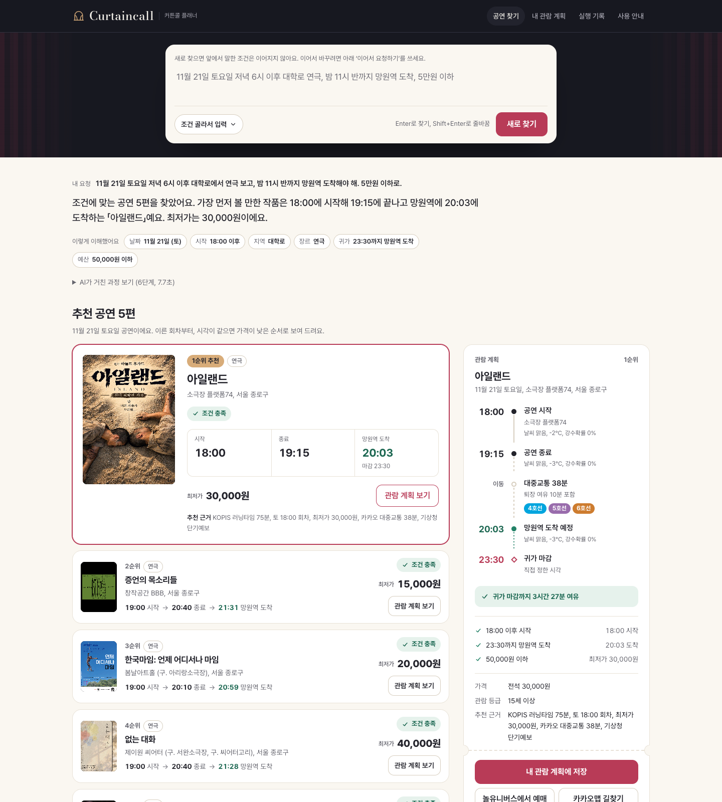

<sub>실제 LLM과 실제 공공 API로 실행한 화면입니다 (응답 7.7초).<br>
“11월 21일 토요일 저녁 6시 이후 대학로에서 연극 보고, 밤 11시 반까지 망원역 도착해야 해. 5만원 이하로.”</sub>

</div>

> [!NOTE]
> **라이브 데모**는 실제 API로 받아 저장해 둔 응답을 실제 Agent 그래프로 처리한 예시 화면이에요. 그래서 어떤 문장을 입력해도 같은 결과가 나와요.
> 원하는 조건으로 실제 검색을 하려면 [직접 실행하기](#-직접-실행하기)를 따라 로컬에서 실행해 주세요.

<br>

## 😮‍💨 이런 고민, 해 본 적 있나요?

> 금요일 퇴근길, *“내일 저녁에 대학로에서 연극 한 편 볼까?”* 싶은데…

| 고민 | 지금은 이렇게 해요 |
|---|---|
| ⏰ **“끝나면 몇 시지?”** | 예매 사이트에는 시작 시각만 크게 있어요. 러닝타임은 상세 페이지를 열어야 보이고, 종료 시각은 직접 계산해요. |
| 🚇 **“막차 전에 집에 갈 수 있을까?”** | 회차마다 지도 앱을 열어 공연장에서 집까지 가는 대중교통을 따로 검색해요. |
| 💸 **“5만 원 안쪽이면 좋겠는데”** | 좌석 등급별 가격이 작품마다 흩어져 있어 한눈에 비교하기 어려워요. |
| 🔍 **“작품 이름을 모르는데…”** | 예매 사이트는 **작품 중심**이라, 조건에 맞는 공연을 찾으려면 수십 개를 하나씩 열어 봐야 해요. |
| 🌧️ **“날씨는 괜찮나?”** | 또 다른 앱을 열어요. |

**결국 예매처 · 지도 · 날씨 앱을 오가며, 회차마다 같은 계산을 반복하게 돼요.**

### 이런 분들을 위해 만들었어요

- 🧑‍💼 퇴근 후 평일·주말 저녁 공연을 즐기는 **직장인**
- 🏠 공연장(대학로)과 집이 멀어 **막차와 귀가 시각을 늘 신경 쓰는 관객**
- 🎓 정해진 **예산** 안에서 고르고 싶은 학생 관객
- 🌱 작품 이름보다 **“언제 · 어디서 · 얼마”**가 먼저인 공연 입문자

<br>

## 💡 한 문장이면 충분해요

예매 사이트가 **작품**에서 출발한다면, 커튼콜 플래너는 **내 조건**에서 출발해요.
한 문장을 받으면 AI 에이전트가 **공연 목록 → 상세(러닝타임·회차·가격) → 공연장과 집 위치 → 대중교통 → 회차별 판정 → 날씨**를 스스로 이어서 확인해요.

> 💬 **“11월 21일 토요일 저녁 6시 이후 대학로에서 연극 보고, 밤 11시 반까지 망원역 도착해야 해. 5만원 이하로.”**
>
> 🎭 **「아일랜드」** 18:00 시작 → 19:15 종료 → **망원역 20:03 도착** · 최저가 30,000원
> ✅ 시작 시각 · 귀가 마감 · 예산 조건 충족 · **귀가 마감까지 3시간 27분 여유** · 외 4편

<br>

## ✨ 주요 기능

### 1. 한 문장으로 찾기

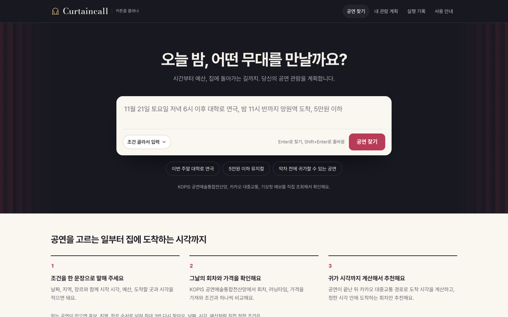

- 날짜, 시작 시각, 지역, 장르, 예산, 귀가 조건을 **자연스럽게 섞어** 써도 돼요.
- AI가 이해한 조건을 **“이렇게 이해했어요”** 칩으로 바로 보여 줘서, 잘못 해석했는지 한눈에 확인할 수 있어요.
- 문장 쓰기가 번거로우면 **조건 골라서 입력**: 날짜·시각·지역·장르·예산·도착할 곳을 고르면 문장으로 만들어 넣어 줘요.

### 2. 집에 도착하는 시각까지 판정한 추천

- 카드 한 장에 **시작 · 종료 · 귀가 도착 시각**과 **최저가**, **추천 근거**를 담았어요.
- 모든 조건을 만족한 회차만 **✅ 조건 충족**으로 추천해요. 맞지 않은 공연은 **조건 미충족**(사유)과 **판정 불가**(확인할 수 없었던 정보)로 나눠 따로 보여 줘요.
- 1순위는 크게, 나머지는 비교하기 쉬운 줄로. 이른 회차부터, 시각이 같으면 가격이 낮은 순서예요.

### 3. 관람 계획 타임라인

<table>
  <tr>
    <td width="50%">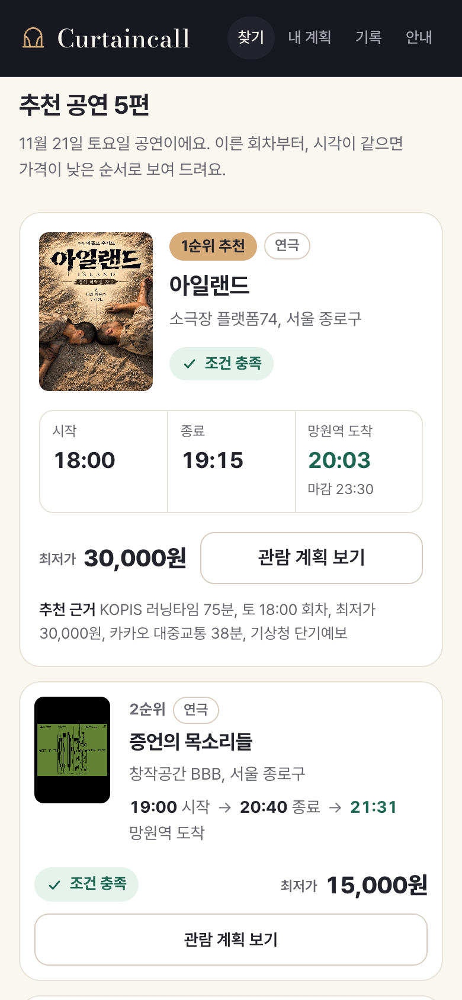</td>
    <td width="50%">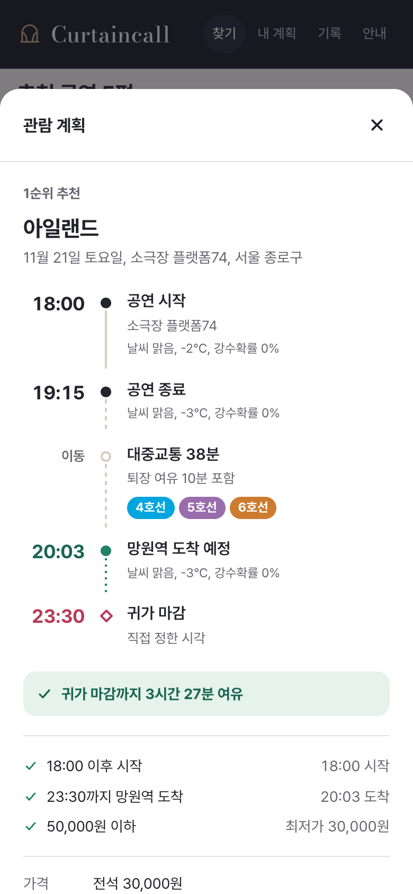</td>
  </tr>
  <tr>
    <td align="center"><sub>모바일 추천 카드</sub></td>
    <td align="center"><sub>관람 계획 — 시작부터 귀가 마감까지</sub></td>
  </tr>
</table>

- **공연 시작 → 종료 → 이동(실제 지하철 노선색) → 도착 예정 → 귀가 마감**을 세로 타임라인으로 보여 줘요.
- 시작·종료·이동·도착을 **모두 확인했을 때만** 귀가 여유 시간을 계산하고, 30분이 안 되면 막차·배차 간격을 확인하라고 경고해요.
- 시간대별 날씨(기상청), 예매처·카카오맵 길찾기 바로가기, **내 관람 계획에 저장**까지 한곳에서.
- 넓은 화면에서는 오른쪽에 고정된 패널로, 모바일에서는 아래에서 올라오는 시트로 열려요.

### 4. 이어서 요청하기 — 대화 맥락을 기억해요

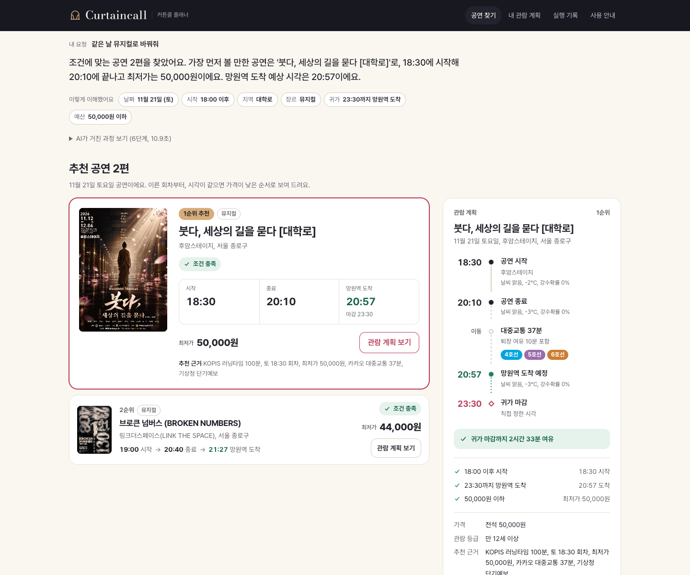

<sub>“같은 날 뮤지컬로 바꿔줘” → 날짜·시각·지역·귀가·예산은 그대로, 장르만 바꿔 다시 찾았어요 (실제 실행 10.9초).</sub>

- **“같은 날 뮤지컬로 바꿔줘”**, **“1번 저장해줘”**처럼 앞의 대화를 이어서 말하면 돼요.
- 위쪽 검색창은 **새 검색**(이전 조건을 이어받지 않음), 아래 **이어서 요청하기**는 **같은 대화**예요.

### 5. 내 관람 계획 · 실행 기록

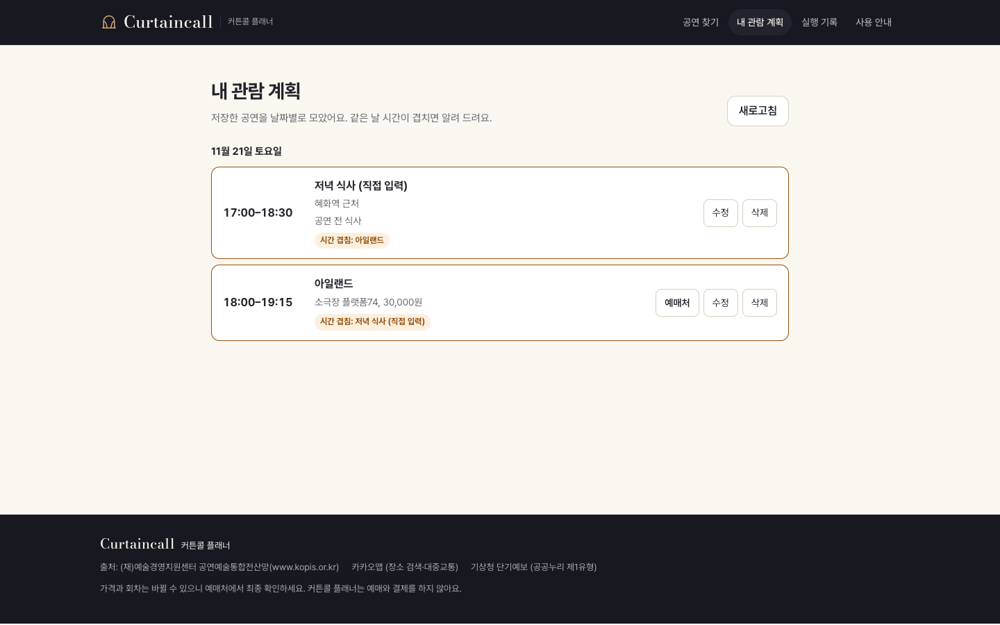

- 저장한 공연을 날짜별로 모아 보여 주고, 같은 날 시간이 겹치면 어떤 계획과 겹치는지 알려 줘요. 수정·삭제는 바로 반영돼요.
- **실행 기록**에서는 요청마다 에이전트가 남긴 이벤트를 볼 수 있어요. 기록은 추가만 되고 수정할 수 없어요.

<br>

## 🤖 AI 에이전트로서의 커튼콜 플래너

### 왜 에이전트여야 할까요?

- LLM 혼자서는 **오늘 상연 중인 회차와 가격을 몰라요.** 외부 데이터가 꼭 필요해요.
- 그런데 API 하나로도 부족해요. 공연 목록에는 러닝타임·가격이 없고, 귀가를 판단하려면 위치와 대중교통 정보가 필요해요.
- 그래서 **여러 Tool을 순서대로 이어 부르고 → 결과로 판정하고 → 맞는 게 없으면 다시 계획하는** 에이전트로 만들었어요.

### 에이전트가 일하는 흐름 (LangGraph)

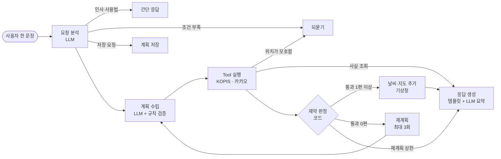

| Tool | 데이터 | 언제 쓰나 |
|---|---|---|
| `search_performances` | KOPIS 공연 목록 | 날짜·지역·장르로 후보 공연을 찾을 때 |
| `get_performance_detail` | KOPIS 공연 상세 | 러닝타임·요일별 회차·가격·공연장을 확인할 때 |
| `search_places` | 카카오 로컬 | 집(도착할 곳)이나 지역의 좌표를 찾을 때 |
| `get_transit_time` | 카카오 대중교통 | 공연장에서 집까지 걸리는 시간을 계산할 때 |
| `get_weather` | 기상청 단기예보 | 관람 시간대 날씨를 덧붙일 때 (판정에는 쓰지 않음) |

### 에이전트가 스스로 판단하는 순간들 — 실제 실행 화면

**🧭 계획: 필요한 Tool을 스스로 고르고, 기다리는 시간도 아껴요**

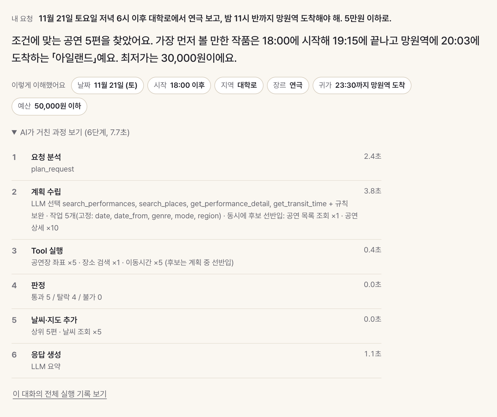

<sub>LLM이 `search_performances`, `search_places`, `get_performance_detail`, `get_transit_time`을 골랐고, 코드가 조건과 대조해 검증한 뒤 작업 순서를 채웠어요. LLM이 계획하는 동안 후보 공연 상세를 미리 조회(선반입)해서 기다리는 시간을 줄였어요.</sub>

**🔁 재계획: 맞는 공연이 없으면 조건을 넓혀 다시 찾아요**

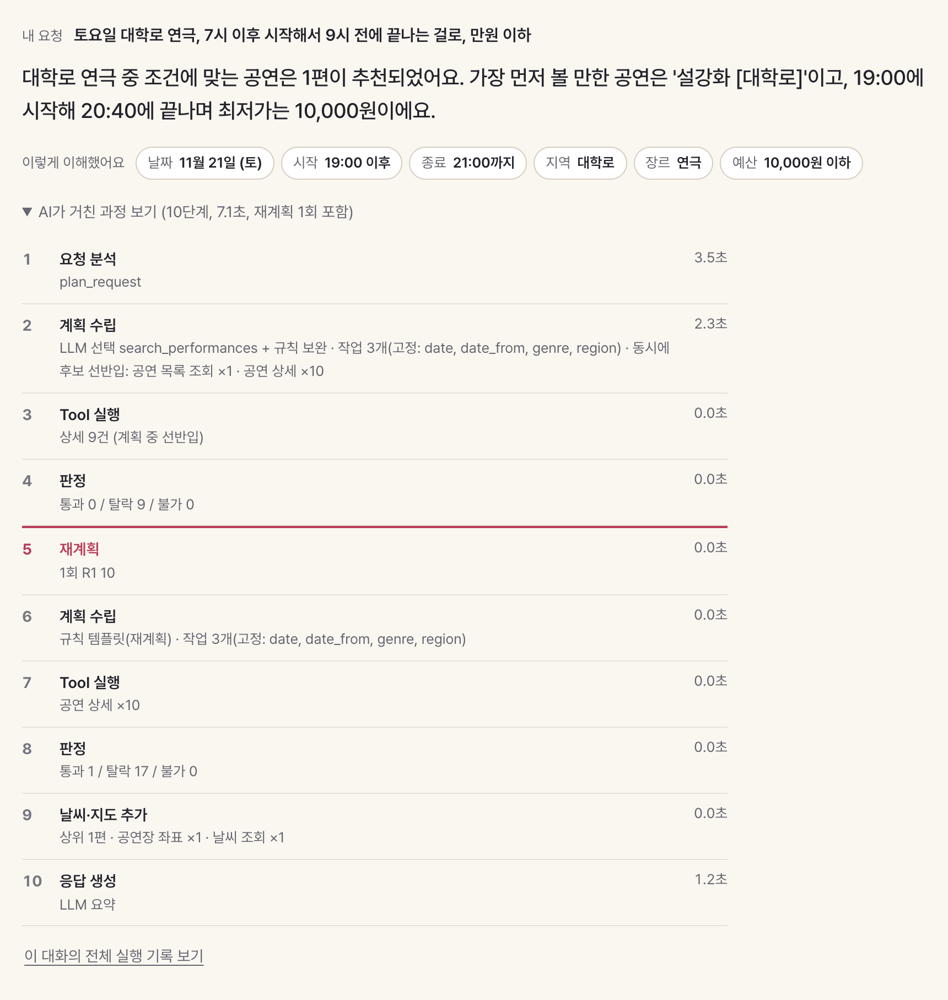

<sub>“토요일 대학로 연극, 7시 이후 시작해서 9시 전에 끝나는 걸로, 만원 이하” → 1차 판정 통과 0편 → **재계획(후보 확장)** → 1편 통과 (실제 실행 7.1초).</sub>

- 넓히는 순서는 **후보 더 가져오기 → 지역 넓히기 → 장르 넓히기**, 최대 3회예요.
- **날짜 · 시작 시각 · 종료/귀가 시각 · 예산처럼 사용자가 정한 조건은 절대 자동으로 바꾸지 않아요.**
- 끝까지 없으면 이미 조회한 값으로 계산한 조정안을 제시해요. 예: “시작 시각을 16:00 이후로 당기면 1편이 가능해요.”

<details>
<summary>재계획 후 결과 화면 보기</summary>

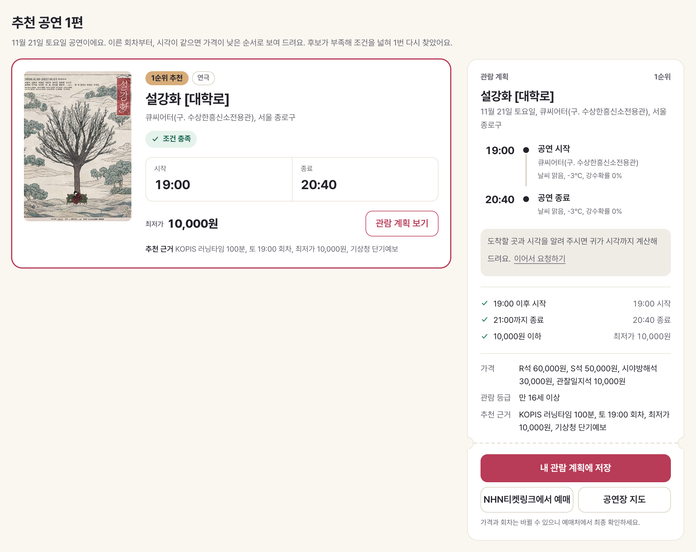

</details>

**❓ 되묻기: 정보가 부족하면 Tool을 부르기 전에 먼저 물어요**

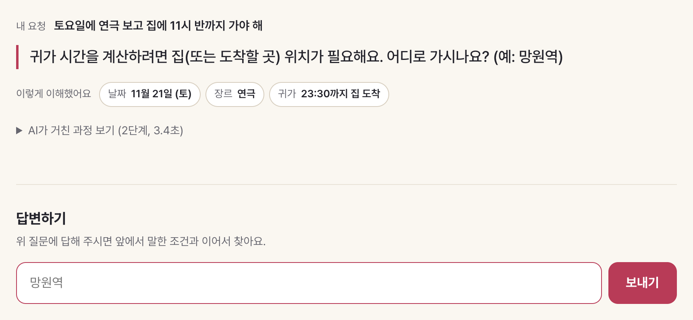

<sub>귀가 조건은 있는데 도착할 곳이 없으면, 외부 API를 한 번도 부르지 않고 먼저 질문해요 (실제 실행 3.4초).</sub>

### LLM은 꼭 필요한 곳에만

| 단계 | 담당 | 이유 |
|---|---|---|
| 요청 분석 (의도 · 조건 추출) | **LLM** · 구조화 출력 | 자연어 이해 |
| 첫 계획 (Tool 선택) | **LLM** + 코드 검증 | 조건과 맞지 않는 선택은 거부하고, 의존 순서는 코드가 보완 |
| 제약 판정 (시작 · 종료 · 귀가 · 예산) | **코드** (순수 함수) | 같은 입력이면 같은 결과, 재현할 수 있어야 함 |
| 재계획 규칙 | **코드** | 무한 반복 방지, 사용자 조건 보호 |
| 응답 요약 | **LLM** | 자연스러운 문장 (숫자는 템플릿이 출력) |
| 로깅 | **코드** (LLM 없음) | 이벤트를 추가만 하는 감사 기록 |

일반 요청 하나에 LLM은 **3번**만 불러요. 판단의 근거가 되는 계산은 모두 코드가 맡아서 결과가 흔들리지 않아요.

### 지어내지 않도록

- 응답에 나오는 **숫자(시각 · 금액 · 분)는 서버 템플릿이 출력**해요. LLM 요약에 결과에 없는 숫자가 들어가면 요약을 버리고 템플릿 문장을 써요.
- 확인할 수 없는 값은 **‘판정 불가’**로 두고, 알 수 있는 값에서 역산한 기준을 대신 보여 줘요. 화면에서도 모르는 값은 **‘확인 필요’**로 표시해요.
- Tool은 예외를 던지지 않고 항상 `{ok, data | error, meta}`로 응답해요. 덕분에 에이전트가 **키 없음 · 결과 없음 · 위치 모호** 같은 실패 종류에 따라 멈춤 · 재계획 · 되묻기를 고를 수 있어요.
- 날씨는 보조 정보예요. 기상청 조회가 실패해도 추천은 정상으로 나와요.

### 심화: Planner · Worker 구조와 비교 실험

Planner가 만든 작업 목록을 Worker가 실행해요. Worker는 정상 경로에서는 LLM을 쓰지 않고, **복구할 수 있는 실패(결과 없음 · 입력 오류)이고 고칠 인자가 있을 때만** LLM으로 재시도 · 건너뛰기 · 재계획 요청을 골라요. 날짜 · 지역 · 장르처럼 고정된 인자를 바꾸려 하면 코드가 거부해요.

실제 LLM과 API로 12개 시나리오를 3번씩 돌려 세 구성을 비교했어요 ([`docs/experiment.md`](docs/experiment.md)).

| 구성 | 성공률 | 평균 재계획 | 요청당 LLM | 평균 응답 | Tool 호출 |
|---|---|---|---|---|---|
| A 단일 Agent | 81% | 0.92회 | 2.22회 | 5.4초 | 25.1회 |
| B Planner·Worker (Worker LLM 끔) | **100%** | 0.33회 | 2.17회 | 5.3초 | 15.4회 |
| C Planner·Worker (Worker LLM 켬, 기본값) | **100%** | 0.33회 | 2.56회 | 5.8초 | 17.2회 |

정상 경로에서는 세 구성이 같았고, 차이는 **카카오가 집 위치를 못 찾는 경우**에서 났어요. A는 헛된 재계획 끝에 실패했고, B는 사용자에게 되물었고, C는 표기를 고쳐 추가 질문 없이 해결했어요.

<br>

## ✅ 검증

| 항목 | 결과 |
|---|---|
| 자동 테스트 | **271개 통과** — 저장된 실제 응답 샘플과 LLM 대역으로, 네트워크 없이 실행 |
| 실제 LLM · 실제 API 시나리오 | **12개 중 11개 기대 동작 충족** ([`docs/verification.md`](docs/verification.md)). 나머지 1개는 실제 데이터에 조건을 만족하는 공연이 있어 재계획이 일어나지 않은 경우 |
| 실행 로그 | 대표 요청 · 재계획 사례 전체 이벤트 ([`docs/logs/`](docs/logs/)) |
| 키 노출 검사 | 0건 (`scripts/scan_secrets.py`) |

README 캡처를 위해 실제로 실행한 결과예요 (2026-11-20).

| 요청 | 결과 | 응답 시간 |
|---|---|---|
| 대표 요청 (대학로 연극 · 망원역 23:30 · 5만 원) | 추천 5편, 재계획 0회 | 7.7초 |
| “같은 날 뮤지컬로 바꿔줘” | 추천 2편, 다른 조건 그대로 유지 | 10.9초 |
| 대학로 연극 · 19~21시 · 만 원 이하 | 1차 0편 → 재계획 1회 → 1편 | 7.1초 |
| 도착할 곳 없이 귀가 조건만 | 되묻기 (Tool 0회) | 3.4초 |

<br>

## 🛠 기술 스택

| 영역 | 기술 |
|---|---|
| **Agent** | LangGraph 1.2 · LangChain 1.3 · Claude Haiku (`claude-haiku-5-5`, SSAFY GMS 경유 · `langchain-openai`) |
| **Backend** | Python 3.10+ · FastAPI · Pydantic · SQLite |
| **Frontend** | 순수 HTML / CSS / JavaScript (빌드 도구 없음) · Pretendard |
| **외부 API** | KOPIS 공연예술통합전산망 · 카카오 로컬 / 대중교통 · 기상청 단기예보 |
| **배포** | Netlify (정적 예시 화면, 키 없이 동작) |

<br>

## 🚀 직접 실행하기

```bash
python3.11 -m venv .venv                                   # Python 3.10 이상
.venv/bin/python -m pip install -r backend/requirements-dev.txt
cp .env.example .env                                       # 키 값을 직접 채워요 (아래 표)
.venv/bin/python -m uvicorn app.main:app --app-dir backend --port 8000
```

- 화면: http://127.0.0.1:8000
- 키 없이 예시 화면: http://127.0.0.1:8000/?demo (외부 호출 0회)
- 테스트: `.venv/bin/python -m pytest`

| 환경 변수 | 발급처 · 값 |
|---|---|
| `KOPIS_API_KEY` | KOPIS → 고객센터 → OPEN API → 인증키 발급 신청 (회원가입 불필요) |
| `KAKAO_REST_API_KEY` | 카카오디벨로퍼스 앱의 REST API 키 · [카카오맵] 사용 설정 ON |
| `KMA_SERVICE_KEY` | 공공데이터포털 “기상청 단기예보 조회서비스” 활용 신청 → **Decoding 키** |
| `GMS_KEY` · `LLM_BASE_URL` · `LLM_MODEL` | LLM 게이트웨이 키 · 접속 주소 · 모델 이름 (`claude-haiku-5-5`) |

> [!IMPORTANT]
> `.env`는 절대 커밋하지 마세요 (`.gitignore`에 등록되어 있어요). 키는 코드에서 `os.getenv`로만 읽고, 로그 · 샘플 · 화면 어디에도 남기지 않아요.
> `LLM_BASE_URL`이 비어 있거나 https가 아니거나 LLM 제공사 주소를 직접 가리키면, 키가 엉뚱한 곳으로 가지 않도록 LLM을 호출하지 않아요.

<details>
<summary>보조 스크립트</summary>

| 스크립트 | 용도 | 외부 호출 |
|---|---|---|
| `scripts/check_keys.py [--live]` | 키 설정 여부 확인 (값은 출력하지 않음) / 4개 API 1회씩 확인 | 0 / 4 |
| `scripts/check_llm.py` | LLM 연결 확인: 짧은 질문 · `bind_tools` · 구조화 출력 | LLM 3~4 |
| `scripts/collect_samples.py` | 실제 응답을 키를 지운 뒤 `backend/samples/`에 저장 | ~65 |
| `scripts/run_scenarios.py` | 검증 시나리오를 실제 LLM + 실제 API로 실행 → `docs/verification.md` | LLM ~32 · API ~200 |
| `scripts/run_experiment.py` | A · B · C 구성 비교 실험 → `docs/experiment.md` | 많음 |
| `scripts/build_static_demo.py` | 정적 예시 배포본 `dist/` 만들기 (Netlify가 실행) | 0 |
| `scripts/scan_secrets.py [--all]` | 커밋 전 키 노출 검사 | 0 |

</details>

<details>
<summary>프로젝트 구조</summary>

```text
backend/app/
  main.py · config.py · llm.py (LLM 객체는 여기서만 만듦)
  api/            chat · plans · logs · health
  agent/          graph(LangGraph) · state · constraints(제약 판정) · relax(재계획 사다리) · worker(Planner·Worker)
    nodes/        understand · planning · execution · respond
  tools/          base(공통 응답·레지스트리) · kopis · kakao · kma · parsers · region_alias · redact
  events/         EventBus — 발행자는 구독자를 몰라요
  logging_agent/  LLM 없이 이벤트를 추가만 하는 로깅 서브 에이전트
  db/             SQLite (관람 계획 · 실행 기록)
backend/tests/    271개 테스트
backend/samples/  키를 지운 실제 API 응답
frontend/         index.html · styles.css · app.js · demo-data.js
docs/             검증 · 실험 결과 · 실행 로그 · 화면 캡처
```

</details>

<br>

## 🧩 만들면서 풀어 낸 문제들

<details>
<summary>트러블슈팅 6가지</summary>

| 문제 | 원인 | 해결 |
|---|---|---|
| LLM 계획이 매번 규칙 템플릿으로 대체됨 | Claude는 `bind_tools`에서 지금 바로 실행할 수 있는 첫 단계 Tool만 고름 | LLM은 “필요한 Tool”을 고르고, 코드가 조건과 대조해 검증한 뒤 의존 순서대로 뒤 단계를 채우도록 재설계 → 대체 0건 |
| 공연 상세 일부가 약 20ms 만에 연속 실패 | KOPIS 방화벽이 몰린 요청을 400 “Request Blocked”로 차단 | 요청 조절(동시 4 · 간격 0.15초), 차단 시 대기 후 1회 재시도 |
| “토요일 밤 대학로 비 와?”에 경북 구미 날씨로 답함 | ‘대학로’만 검색하면 구미, ‘서울 대학로’는 시흥이 1위 | 지역 별칭으로 구까지 알아내 ‘서울 종로구 대학로’로 검색하고, 결과도 그 구 안에서만 고름 |
| LLM 호출이 모두 HTTP 400 | 모델이 `temperature`를 받지 않음 | 보내지 않고, 일관성은 코드 검증(형식 · 계획 규칙 · 요약 숫자 대조)이 맡음 |
| 키가 LLM 객체 출력에 그대로 보임 | 헤더를 `default_headers`(pydantic 필드)에 넣으면 repr에 노출 | 키 헤더를 HTTP 클라이언트로 옮기고 테스트로 고정 |
| 응답 시간이 길게 흔들림 | KOPIS 처리량이 초당 약 1.5건 | 2단계 판정(1차 통과 후보만 위치·교통 조회), 좌표 지연 조회, LLM 계획 중 후보 선반입 |

</details>

<details>
<summary>설계 결정 Q&A</summary>

| 질문 | 답 |
|---|---|
| LLM을 어디에 썼나요? | 의도 분석 · 첫 계획 · 요약 세 곳만요. 판정 · 재계획 · 겹침 검사 · 로깅은 순수 함수라 재현할 수 있고 비용이 예측돼요. |
| Tool 선택을 LLM에 어떻게 맡겼나요? | LLM이 필요한 Tool을 고르면, 코드가 조건과 대조해 검증해요. 예를 들어 귀가 조건이 없는데 이동 시간을 고르면 거부하고, 빠진 단계는 의존 순서대로 채워요. |
| 재계획이 무한히 반복되지 않나요? | 상한 3회, 완화 사다리를 다 쓰면 종료, 키 없음처럼 다시 해도 같은 실패는 재계획하지 않아요. |
| 로깅을 왜 분리했나요? | 발행자는 구독자를 몰라서 로깅 장애가 대화에 영향을 주지 않아요. 로그는 수정할 수 없어요(추가 · 삭제만). |
| 외부 API 호출은 어떻게 아꼈나요? | 시간 · 예산을 먼저 통과한 후보만 위치 · 대중교통을 조회하고, 시설 · 경로 · 예보는 캐시해요. 예보 범위 밖 날짜는 기상청을 아예 부르지 않아요. |

</details>

<br>

## 🧭 한계와 다음 단계

- **응답 시간은 KOPIS 상태에 따라 달라져요.** 재계획 없는 요청이 빠를 때는 6~8초, 느릴 때는 20초 안팎이에요.
- 장르는 연극 · 뮤지컬 · 클래식, 구 단위 지역은 서울만 지원해요. 공휴일 회차는 판정에 쓰지 않아요.
- 대중교통 시간은 시간대 · 막차를 반영하지 않아요. 그래서 귀가 여유가 30분보다 적으면 화면에서 경고해요.
- 대화 Memory는 서버 메모리에 있어서 서버를 다시 켜면 초기화돼요.
- 실제 검색까지 되는 전체 앱의 공개 배포는 접속 비밀번호 · 요청 제한을 갖춘 뒤에 할 계획이에요.

<br>

## 📚 데이터 출처

- 출처: (재)예술경영지원센터 공연예술통합전산망(www.kopis.or.kr)
- 카카오맵 (장소 검색 · 대중교통)
- 기상청 단기예보 (공공누리 제1유형)

가격과 회차는 바뀔 수 있으니 예매처에서 최종 확인하세요. 커튼콜 플래너는 예매와 결제를 하지 않아요.

<div align="center">
<br>
<sub>🎭 Curtaincall · 커튼콜 플래너 — SSAFY 프로젝트</sub>
</div>
