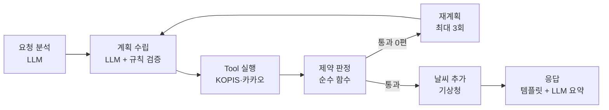

# 🎭 커튼콜 플래너 — 프로젝트 소개

> 내 시간 · 예산 · 귀가 조건에 맞는 **공연과 회차**를 찾아 관람 계획으로 만들어 주는 LangGraph Agent 서비스

## 1. 왜 만들었나

예매 사이트는 작품 이름으로 찾게 되어 있습니다. 하지만 실제로 궁금한 건 조건입니다.
"몇 시에 끝나지?", "끝나고 막차 전에 집에 갈 수 있나?", "5만원 안쪽인가?"

이 질문에 답하려면 공연 목록 → 상세(러닝타임·회차·가격) → 공연장 위치 → 대중교통 시간을 이어서 조회하고 판정해야 합니다.
LLM 혼자서는 지금 상연 중인 회차와 가격을 모르고, API 한 번으로도 답이 나오지 않습니다. 그래서 여러 Tool을 계획하고 실행하는 **Agent**로 만들었습니다.

**예시 요청**
> "11월 21일 토요일 저녁 6시 이후 대학로에서 연극 보고, 밤 11시 반까지 망원역 도착해야 해. 5만원 이하로."

**결과:** 추천 5편. 1위는 「아일랜드」 18:00 시작 → 19:15 종료 → 망원역 20:03 도착, 30,000원입니다(실제 LLM·API로 실행).

## 2. 동작 흐름



- **Tool 5개:** 공연 검색, 공연 상세, 장소 검색, 대중교통 시간, 날씨
- **재계획 순서:** 후보 더 가져오기 → 지역 넓히기 → 장르 넓히기. 사용자가 정한 날짜·시각·예산은 자동으로 바꾸지 않습니다.
- **Memory:** "같은 날 뮤지컬로 바꿔줘"라고 하면 다른 조건은 유지하고 장르만 바꿉니다.
- **로깅 서브 Agent:** 이벤트를 구독해 추가만 합니다. 로그를 수정하는 API는 없습니다.

## 3. 핵심 설계 결정

| 결정 | 이유 |
|---|---|
| LLM은 분석·계획·요약 **세 곳에만** 사용 | 판정·재계획·겹침 검사는 코드(순수 함수)가 맡아서 결과가 재현되고 비용이 예측됩니다 |
| 숫자는 템플릿이 출력하고 LLM은 요약 문장만 작성 | 시각·금액 환각을 막습니다. 요약에 결과에 없는 숫자가 있으면 템플릿 문장으로 바꿉니다 |
| 확인할 수 없는 값은 '판정 불가' + 역산한 기준 제시 | 값을 지어내지 않습니다 |
| Tool은 예외를 던지지 않고 `{ok, data/error, meta}` 형식으로 응답 | Agent가 실패 종류(키 없음·결과 없음·모호함)에 따라 재시도·재계획·되묻기를 고를 수 있습니다 |
| 2단계 판정: 시간·예산을 통과한 후보만 위치·교통 조회 | 외부 API 호출을 줄입니다(카카오 대중교통은 하루 1,000건) |
| 날씨는 보조 정보 | 기상청이 실패해도 추천은 정상으로 나옵니다 |

## 4. 심화 과제 — Planner·Worker (F3021)

Worker는 정상 경로에서는 LLM을 쓰지 않습니다. 집 위치를 찾지 못한 경우처럼 **고칠 수 있는 실패**일 때만 LLM으로 입력을 고쳐 다시 시도합니다.
같은 시나리오 12개를 3회씩 돌려 세 구성을 비교했습니다.

| 구성 | 성공률 | 요청당 LLM 호출 | 평균 응답 시간 |
|---|---|---|---|
| A 단일 Agent | 81% | 2.22회 | 5.4초 |
| B Planner·Worker (Worker LLM 끔) | 100% | 2.17회 | 5.3초 |
| C Planner·Worker (Worker LLM 켬, 기본값) | 100% | 2.56회 | 5.8초 |

## 5. 기술 스택

- **백엔드:** Python · FastAPI · SQLite · LangGraph · LangChain
- **LLM:** `claude-haiku-5-5` (SSAFY GMS 경유)
- **외부 API:** KOPIS 공연예술통합전산망 · 카카오맵(로컬·대중교통) · 기상청 단기예보
- **프론트:** 순수 HTML/CSS/JS. 추천 결과를 티켓 모양 카드로 보여 주고, 실행 과정을 단계 목록으로 표시합니다.

## 6. 검증

- 테스트 271개 통과. 저장된 실제 응답 샘플과 LLM 대역을 써서 네트워크 없이 실행합니다.
- 실제 LLM과 실제 API로 검증 시나리오 12개 중 **11개가 기대대로** 동작했습니다. 나머지 1개는 결함이 아니라, 실제 데이터에 조건을 만족하는 공연이 있어서 재계획이 일어나지 않은 경우입니다. 자세한 내용은 [verification.md](verification.md)에 있습니다.
- 키 노출 검사 결과 0건입니다.

## 7. 실행 방법

```bash
python3.11 -m venv .venv
.venv/bin/python -m pip install -r backend/requirements-dev.txt
cp .env.example .env          # 키 값을 직접 채웁니다
.venv/bin/python -m uvicorn app.main:app --app-dir backend --port 8000
```

- 화면: http://127.0.0.1:8000
- 키 없이 예시 화면 보기: `frontend/index.html?demo`

## 8. 한계

- 응답 시간이 KOPIS 상태에 따라 6~20초로 달라집니다(KOPIS 처리량이 초당 약 1.5건).
- 장르는 연극·뮤지컬·클래식만, 구 단위 지역은 서울만 지원합니다. 공휴일 회차는 판정에 쓰지 않습니다.
- Memory는 서버 메모리에만 있어서, 서버를 다시 켜면 대화 맥락이 사라집니다.

---
출처: (재)예술경영지원센터 공연예술통합전산망(www.kopis.or.kr) · 카카오맵 · 기상청 단기예보(공공누리 제1유형)
